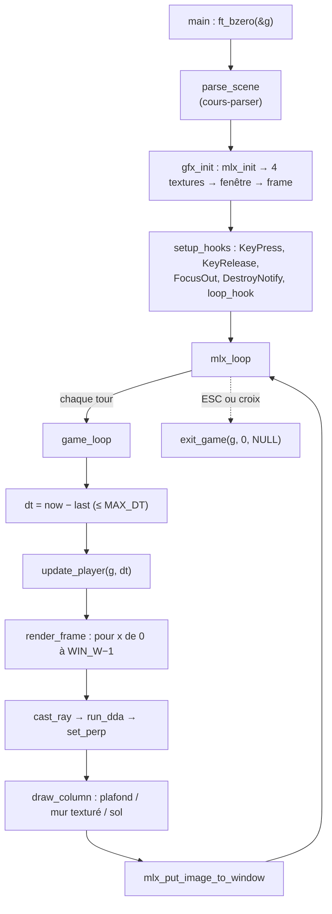

# Cours : le moteur de cub3D (modules G, R, I, M, E)

> [!abstract] Objectif de ce cours
> Le parser a son propre cours ([cours-parser](../cours-parser/00%20-%20Index.md)). Celui-ci couvre **tout le reste** : la MiniLibX, le raycasting, la boucle de jeu, la sortie propre et le build. À la fin, tu dois pouvoir **dérouler une frame complète** au tableau, de `mlx_loop` jusqu'au pixel, et **justifier** chaque formule.

## Ordre de lecture

1. [01 - Cycle de vie du programme](01%20-%20Cycle%20de%20vie%20du%20programme.md) : `main`, ordre d'initialisation, ordre de destruction
2. [02 - G1 Framebuffer et pixels](02%20-%20G1%20Framebuffer%20et%20pixels.md) : pourquoi une image, `line_len`, `put_pixel`
3. [03 - G2 Hooks et clavier](03%20-%20G2%20Hooks%20et%20clavier.md) : touches maintenues, ESC, croix, Alt+Tab
4. [04 - G3 Textures XPM](04%20-%20G3%20Textures%20XPM.md) : chargement, `get_texel`, pourquoi avant la fenêtre
5. [05 - R1 Rayons et caméra](05%20-%20R1%20Rayons%20et%20camera.md) : `dir`, `plane`, `camera_x`, FOV
6. [06 - R2 DDA](06%20-%20R2%20DDA.md) : `delta`, `side`, `step`, avancer de case en case
7. [07 - R3 Distance et hauteur](07%20-%20R3%20Distance%20et%20hauteur.md) : `perp`, pas de fisheye, `line_h`
8. [08 - R4 R5 Colonne et texture](08%20-%20R4%20R5%20Colonne%20et%20texture.md) : choix de la face, `wall_x`, `tex_x`, `tex_pos`
9. [09 - Boucle de jeu et mouvement](09%20-%20Boucle%20de%20jeu%20et%20mouvement.md) : delta-time, rotation, collision (état actuel **TEMP**)
10. [10 - Build, tests et ressources](10%20-%20Build%2C%20tests%20et%20ressources.md) : Makefile, `-std=gnu17`, scripts, textures
11. [11 - Soutenance](11%20-%20Soutenance.md) : questions de correcteur, modifications live, exercices

## Carte des fichiers

| Unité | Fichier | Fonctions publiques | Rôle |
|---|---|---|---|
| I1 | `mandatory/main.c` | `main` | enchaîne parsing → gfx → hooks → boucle |
| E1 | `core/exit/exit.c`, `free.c` | `exit_game`, `destroy_gfx`, `free_scene`, `free_tab` | **seule** sortie du programme |
| G1 | `core/gfx/gfx_init.c`, `pixel.c` | `gfx_init`, `put_pixel` | connexion X, fenêtre, framebuffer |
| G2 | `core/gfx/keys.c`, `mandatory/hooks.c` | `on_key_press`, `on_key_release`, `on_focus_out`, `on_close`, `setup_hooks` | état du clavier, fermeture |
| G3 | `core/gfx/gfx_init.c`, `pixel.c` | `load_texture` (static), `get_texel` | textures XPM |
| R1–R3 | `core/render/raycast.c` | `cast_ray`, `run_dda` | un rayon → une distance |
| R4–R5 | `core/render/column.c`, `frame.c` | `draw_column`, `render_frame` | une distance → une colonne de pixels |
| — | `mandatory/rules.c` | `is_solid`, `select_texture` | points de variation mandatory/bonus |
| I1/M | `mandatory/loop.c` | `game_loop` | une frame : temps → mouvement → rendu → affichage |
| M1/M2 | `mandatory/temp_move.c` ⚠️ | `now_seconds`, `update_player` | **provisoire**, à remplacer par `core/move/` |

## Le programme en une image

## État vérifié (2026-10-29)

- Fait : E1, G1, G2, G3, R1 à R5, I1. Le jeu s'affiche et on peut se déplacer.
- **Provisoire** : `now_seconds` et `update_player` vivent dans `mandatory/temp_move.c` (marqué `TEMP`). `core/move/` est vide. Voir [09](09%20-%20Boucle%20de%20jeu%20et%20mouvement.md) pour ce qu'il manque.
- Pas encore fait : règle `bonus` du Makefile, `src/bonus/`, passage Q1 à Q4 (tests complets, Norme, valgrind, relecture croisée).
