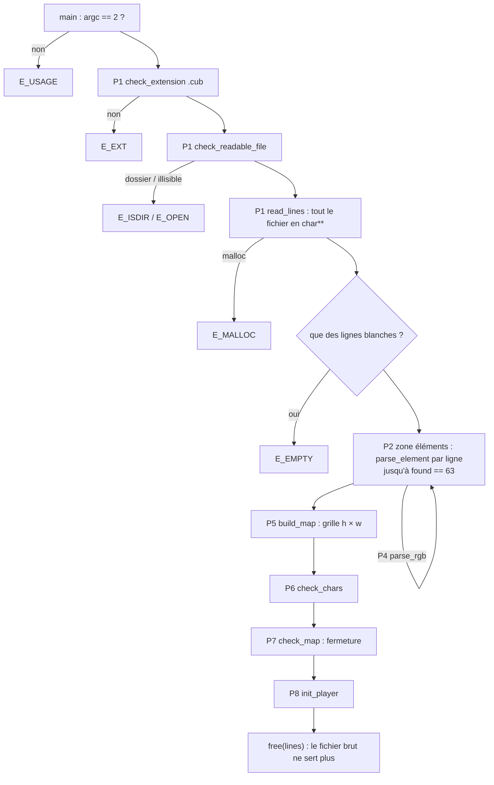

# 01 · Vue d'ensemble

← [Index](00%20-%20Index.md)

## Le pipeline

Le parser est une **chaîne d'étapes**. Chaque étape suppose que les précédentes ont réussi, ce qui la rend simple.



Dans le code, ce pipeline tient en trois fonctions de `parse_scene.c` :

```c
void	parse_scene(t_game *g, char *path)
{
	...                                   /* P1 */
	if (all_blank(g->sc.lines))
		exit_game(g, 1, E_EMPTY);
	parse_map(g, parse_elements(g));      /* P2..P4 puis P5..P8 */
	free_tab(g->sc.lines);
	g->sc.lines = NULL;
}
```

`parse_elements` renvoie **l'indice de la ligne qui suit le 6e élément**. C'est le point de départ de la map, et le seul lien entre les deux moitiés du parser.

## Décision n°1 : une erreur, c'est une chaîne

Toutes les fonctions « feuilles » renvoient un `char *` :
- `NULL` → tout va bien ;
- sinon → **le message lui-même**, par exemple `E_DUP`, qui est un littéral `"element defined twice"`.

```c
msg = parse_element(g, line);
if (msg)
	exit_game(g, 1, msg);
```

> [!question] Pourquoi pas un `int` code d'erreur + un tableau de messages ?
> - Le message est **auto-documenté** : `return (E_DUP);` se lit tout seul.
> - C'est un **littéral** (zone en lecture seule) : rien à allouer, donc rien à libérer, même en cas d'erreur.
> - Une fonction intermédiaire peut **propager** l'erreur sans la connaître : `if (msg) return (msg);`.
>
> `parse_rgb` et `check_map` renvoient un `int` parce qu'elles n'ont qu'**une seule** cause d'échec : c'est l'appelant qui choisit le message.

## Décision n°2 : seul `parse_scene` appelle `exit_game`

Les fonctions feuilles ne quittent jamais le programme. Elles **signalent**, et le chef d'orchestre décide.

| Avantage | Pourquoi ça compte |
|---|---|
| Testable | `t_elements.c` appelle `parse_element` 9 fois de suite dans un même `main`. Une fonction qui fait `exit` rendrait ce test impossible. |
| Une seule sortie | Toute la mémoire est rattachée à `g`, et `exit_game(g, …)` sait tout libérer (voir [09](09%20-%20Memoire%20et%20erreurs.md)). |
| Lisible | En lisant `parse_scene.c`, on voit **toutes** les sorties possibles du parsing. |

## Décision n°3 : la première erreur gagne

Un fichier qui cumule « mauvaise extension » et « map ouverte » affiche `E_EXT`. On ne cherche pas à lister **toutes** les erreurs : l'ordre du pipeline suffit, et il est facile à expliquer. Le sujet demande juste `Error\n` suivi d'un message explicite.

## Décision n°4 : tout est découpé pour la Norme, pas au hasard

Chaque `static` a un nom qui dit **ce qu'il fait** (`elem_id`, `parse_value`, `fill_grid`, `touches_void`…). Le découpage suit les **étapes logiques**, pas seulement la limite des 25 lignes. Un correcteur peut te demander « que fait cette fonction ? », et la réponse doit tenir en une phrase.

## À retenir en 3 lignes

1. Pipeline linéaire : chaque étape fait confiance aux précédentes.
2. Erreur = `char *` message (ou `int` s'il n'y a qu'une cause), jamais alloué.
3. `exit_game` n'est appelé qu'à un seul endroit.

→ Suite : [02 - P1 Lecture du fichier](02%20-%20P1%20Lecture%20du%20fichier.md)
