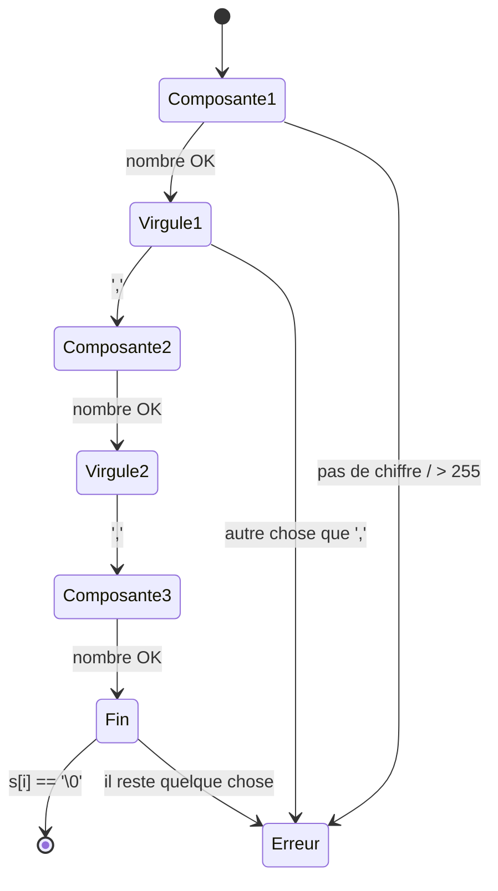

# 05 · P4 Couleurs (un automate)

← [Index](00%20-%20Index.md) · Fichier : `color.c`

## Le contrat

`int parse_rgb(char *s, int *out)` : 0 si OK et `*out = 0x00RRGGBB`, 1 sinon. **Aucune allocation.**

On accepte exactement :

```
espaces* chiffres+ espaces* , espaces* chiffres+ espaces* , espaces* chiffres+ espaces* FIN
```

## L'idée : un curseur qui avance une seule fois

C'est la technique de `ft_atoi` : un indice `i` avance de gauche à droite, et **tout caractère inattendu arrête la lecture avec une erreur**. On ne revient jamais en arrière.



`read_component` lit « espaces, nombre, espaces » :

```c
while (ft_isdigit(s[*i]))
{
	*val = *val * 10 + (s[*i] - '0');
	nb++;
	(*i)++;
	if (*val > 255)          /* refusé PENDANT la lecture */
		return (1);
}
if (nb == 0)                 /* aucun chiffre : composante vide */
	return (1);
```

> [!important] Pourquoi le test `> 255` est **dans** la boucle
> `99999999999999999999` s'arrête au 3e chiffre (999 > 255). La valeur ne dépasse jamais 2 559, donc **aucun overflow d'`int` n'est possible**, quelle que soit la longueur de l'entrée.

## Pourquoi pas `ft_atoi` ni `ft_split`

| Outil | Ce qui casse |
|---|---|
| `ft_atoi` | accepte `+10` et `-1`, déborde en silence sur `99999999999999999999`, s'arrête sans erreur sur `22a` |
| `ft_split(s, ',')` | **fusionne** les virgules : `"220,100,0,"`, `",220,100,0"` et `"220,,100,0"` donnent tous 3 morceaux et passeraient |

L'automate refuse tout ça **naturellement**, sans cas particulier :

| Entrée | Où ça casse |
|---|---|
| `+10,0,0` | `+` n'est pas un chiffre → `nb == 0` |
| `22a,100,0` | après `22`, on attend `,` mais on trouve `a` |
| `2 20,100,0` | après `2` et l'espace, on attend `,` mais on trouve `2` |
| `0xFF,0,0` | après `0`, on attend `,` mais on trouve `x` |
| `1.5,0,0` | `.` au lieu de `,` |
| `220,100,0,` | après la 3e composante, `s[i]` vaut `,` et non `\0` |
| `220,,0` | 2e composante : `nb == 0` |
| `""` (ligne `F` seule) | 1re composante : `nb == 0` |

Et sont acceptés **sans code en plus** :
- `000,010,255` : les zéros de tête ne font pas grossir la valeur ;
- `220 , 100 ,0` : les espaces autour des virgules (choix, et le sujet lui-même écrit `0, 255, 255`) ;
- `0,0,0` : le noir est valide. C'est `found` qui dit si F existe, pas la valeur 0.

## Composer `0x00RRGGBB`

```c
rgb = (rgb << 8) | val;      /* répété 3 fois */
```

Exemple avec `220,100,0` :

| Étape | `rgb` avant | `<< 8` | `\| val` | `rgb` après |
|---|---|---|---|---|
| R = 220 (`0xDC`) | `0x000000` | `0x000000` | `0xDC` | `0x0000DC` |
| G = 100 (`0x64`) | `0x0000DC` | `0x00DC00` | `0x64` | `0x00DC64` |
| B = 0 (`0x00`) | `0x00DC64` | `0xDC6400` | `0x00` | `0xDC6400` |

Décaler de 8 bits fait de la place pour un octet (0 à 255). C'est exactement `(r << 16) | (g << 8) | b`, mais calculé au fil de la lecture. C'est le format de pixel qu'attend la MLX (`put_pixel`).

→ Suite : [06 - P5 Construction de la grille](06%20-%20P5%20Construction%20de%20la%20grille.md)
